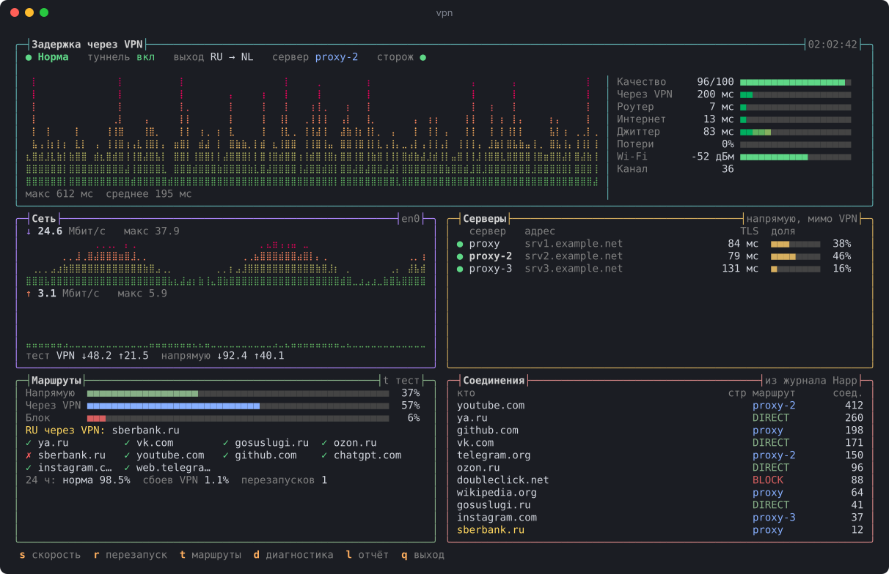
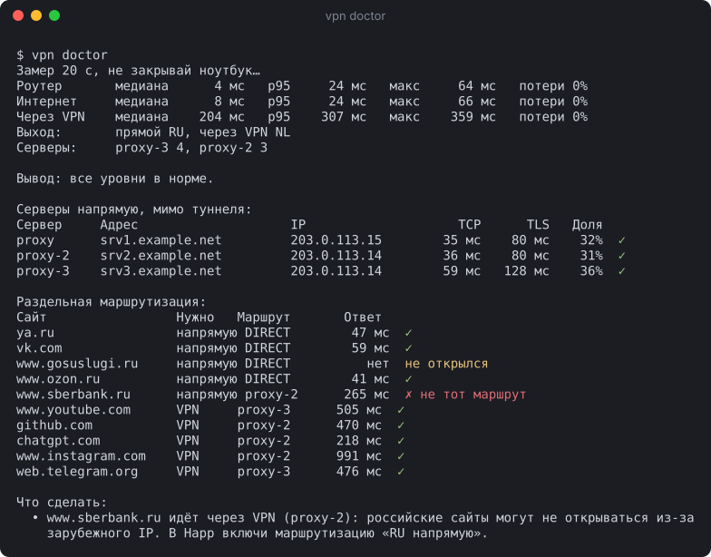
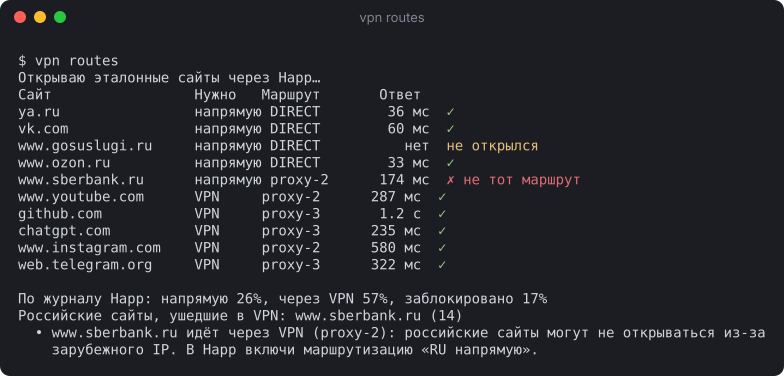

# vpnguard

Сторож и панель диагностики для VPN-клиента Happ на macOS.

vpnguard проверяет соединение по уровням, отличает проблемы Wi-Fi и провайдера от сбоя VPN,
проверяет серверы мимо туннеля, контролирует раздельную маршрутизацию и перезапускает туннель,
когда сломан именно он.



## Возможности

- **Диагностика по уровням:** роутер, прямой интернет, туннель, трафик через прокси.
- **Проверка серверов напрямую.** TCP и TLS до каждого сервера через физический интерфейс, мимо туннеля.
- **Обнаружение обхода VPN.** Если все серверы недоступны и балансировщик Happ переключился на `DIRECT`, это отдельное состояние.
- **Раздельная маршрутизация.** Российские сайты должны идти напрямую, остальные через VPN.
- **Анализ трафика.** Доли маршрутов, активные адреса, страна и владелец сети для каждого IP.
- **Автопочинка.** Перезапуск туннеля по серии сбоев, с лимитами и уведомлениями.
- **Замер скорости** через VPN и напрямую.
- **Журнал и отчёт** за любой период.

Один файл на Python, только стандартная библиотека и системные утилиты macOS.

## Установка

```sh
curl -fsSL https://raw.githubusercontent.com/Uzalov-Gamid/vpnguard/main/install.sh | sh
```

Или из исходников:

```sh
git clone https://github.com/Uzalov-Gamid/vpnguard.git
cd vpnguard
./vpnguard install
```

Установка кладёт программу в `~/.local/bin`, создаёт команду `vpn` и регистрирует сторож
в `launchd`, поэтому он работает в фоне и после перезагрузки. Если `vpn` не находится,
добавь `~/.local/bin` в `PATH`.

Требования: macOS, Happ, Python 3.9+ (входит в Command Line Tools: `xcode-select --install`).

## Команды

| Команда | Описание |
|---|---|
| `vpn` | Живая панель |
| `vpn status` | Мгновенная проверка всех уровней, код выхода 0 при норме |
| `vpn doctor [секунд]` | Замер задержки и потерь, проверка серверов и маршрутов, рекомендации |
| `vpn servers` | Доступность серверов мимо туннеля и доля трафика через каждый |
| `vpn routes` | Проверка раздельной маршрутизации |
| `vpn speed` | Скорость загрузки и отдачи через VPN и напрямую |
| `vpn report [часов]` | Статистика из журнала |
| `vpn restart` | Перезапуск туннеля |
| `vpn config [файл\|-]` | Импорт JSON-конфига сервера из Happ |
| `vpn watch` | Сторож (обычно запускается через `launchd`) |
| `vpn install`, `vpn uninstall` | Установка и удаление сторожа |

Клавиши панели: `s` скорость, `r` перезапуск, `t` маршруты, `d` диагностика, `l` отчёт, `q` выход.

## Диагностика



Проверки идут снизу вверх: верхний уровень имеет смысл проверять, только если работает нижний.

```text
роутер ──► интернет ──► туннель ──► трафик через SOCKS ──► выбранный outbound
ping шлюза  ping 77.88.8.8  scutil --nc  curl generate_204   журнал Xray
```

| Состояние | Значение | Действие сторожа |
|---|---|---|
| `OK` | Всё работает | — |
| `LOCAL` | Сбой Wi-Fi или роутера | Нет, перезапуск VPN не поможет |
| `ISP` | Роутер отвечает, интернета нет | Нет, проблема у провайдера |
| `VPN_DOWN` | Туннель выключен | Включает его с `--keep-on` |
| `VPN_BROKEN` | Сеть есть, через VPN трафик не идёт | Перезапуск туннеля |
| `LEAK` | Серверы недоступны, трафик идёт напрямую | Уведомление и перезапуск туннеля |

**Обход VPN.** У балансировщика Happ обычно задан `fallbackTag: DIRECT`. Когда все серверы
недоступны, трафик уходит напрямую, и обычная проверка «сайт открылся» проходит. vpnguard находит
свой запрос в журнале Xray по локальному порту и видит, через какой outbound он ушёл на самом деле.

**Серверы мимо туннеля.** Адрес сервера резолвится через DoH по физическому интерфейсу, затем
проверяются TCP и TLS-рукопожатие с нужным SNI. Если не отвечает ни один сервер, перезапуск
туннеля бесполезен: дело в блокировке или в самих серверах.

## Раздельная маршрутизация



`vpn routes` открывает через Happ набор эталонных сайтов (Яндекс, VK, Госуслуги, Ozon, Сбер,
YouTube, GitHub, ChatGPT, Instagram, Telegram) и по журналу Xray определяет маршрут каждого.
Российские должны идти через `DIRECT`, остальные через сервер. Дополнительно разбирается журнал
Happ: доли маршрутов и российские адреса, ушедшие в туннель (по домену или по стране IP).

## Автопочинка

Сторож проверяет соединение каждые 10 секунд и пишет результат в журнал.

1. После нескольких сбоев подряд (`VPN_BROKEN` или `LEAK`) перезапускает туннель.
2. Если перезапуск не помог, проверяет серверы напрямую и присылает уведомление с причиной.
3. Соблюдает паузу между перезапусками и лимит в час.
4. С `--keep-on` включает туннель, если он выключился.

Сбой Wi-Fi перезапуск туннеля не вызывает.

```sh
vpn watch --interval 10 --fails 4 --cooldown 180 --max-per-hour 4 --keep-on
```

## Конфиг Happ

Happ хранит конфиги в зашифрованном виде, поэтому адреса серверов передаются через импорт JSON:

```sh
pbpaste | vpn config -
vpn config ~/Downloads/server.json
vpn config                  # текущий конфиг
```

Пример структуры: [`examples/happ.example.json`](examples/happ.example.json).
Без конфига работает всё, кроме проверки серверов напрямую.

## Файлы

| Путь | Назначение |
|---|---|
| `~/.local/bin/vpnguard`, `~/.local/bin/vpn` | Программа и короткая команда |
| `~/Library/LaunchAgents/com.vpnguard.plist` | Автозапуск сторожа |
| `~/Library/Logs/vpnguard.jsonl` | Журнал проверок |
| `~/.config/vpnguard/happ.json` | Импортированный конфиг |
| `~/.cache/vpnguard/ip.json` | Кэш стран и владельцев IP |

## Удаление

```sh
vpn uninstall
rm -rf ~/.config/vpnguard ~/.cache/vpnguard
```
